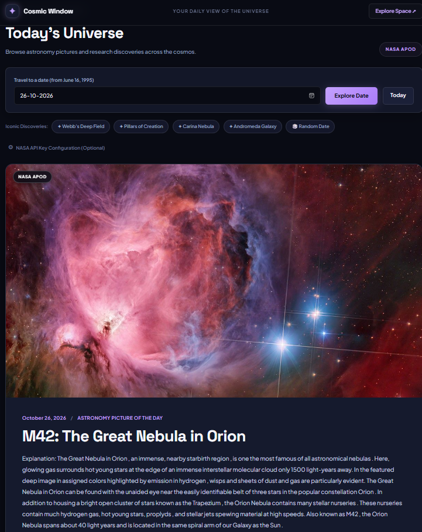

# 04. Cosmic Window — Space Discovery Explorer

A real-time space exploration portal querying NASA's Astronomy Picture of the Day (APOD) public APIs. Features asynchronous data fetching, historical date traveling, multiple UI state machines, and resilient fallback strategies.

---

## 📸 UI Preview

*Figure 4: Space discovery explorer featuring date travel controls, iconic milestone presets (James Webb Deep Field, Pillars of Creation), loading/error states, and high-resolution NASA imagery display.*

---

## 🚀 Live Demo
- **Live URL**: [https://sowndharyapl15.github.io/frontend-task/Async%20JS-cosmic-window/](https://sowndharyapl15.github.io/frontend-task/Async%20JS-cosmic-window/)

---

## 🛠️ Tech Stack & Key Topics Demonstrated

- **Asynchronous JavaScript**: `async/await`, Promises, and the `Fetch API`.
- **NASA APOD API Integration**: Direct retrieval of daily astronomical photography and scientific research.
- **Dual-Source Architecture & Fallbacks**:
  - Primary: Direct NASA CMS endpoint parsed with regex to bypass the legacy `nasa-logo@2x.png` placeholder bug.
  - Secondary: NASA Open API (`api.nasa.gov`) with query parameter serialization.
  - Fallback: Curated offline space discoveries for rate limits (429) or connection loss.
- **Complete UI State Machine**:
  - **Loading State**: Orbiting cosmic ring animation with transmission status text.
  - **Error State**: Diagnostic messages, retry buttons, and archive recovery links.
  - **Success State**: Rich display with title, formatted date, scientific explanation, image credits, and HD download link.
- **Adaptive Media Switching**: Dynamic toggling between responsive `` and embedded video `<iframe>` (YouTube/Vimeo).
- **Date Travel Search**: Historical boundaries (June 16, 1995 to today) and random date generator.
- **Custom API Key Support**: Modal drawer allowing personal API key configuration stored in `localStorage`.

---

## 📁 File Structure

- `index.html`: Space explorer UI, date toolbar, preset chips, and discovery card container.
- `style.css`: Cosmic dark theme, starlight accents, orbiting spinner animations, and responsive media styles.
- `script.js`: Asynchronous fetch pipeline, HTML parser, state management, and media rendering.
- `Screenshot.png`: High-resolution UI preview screenshot.
