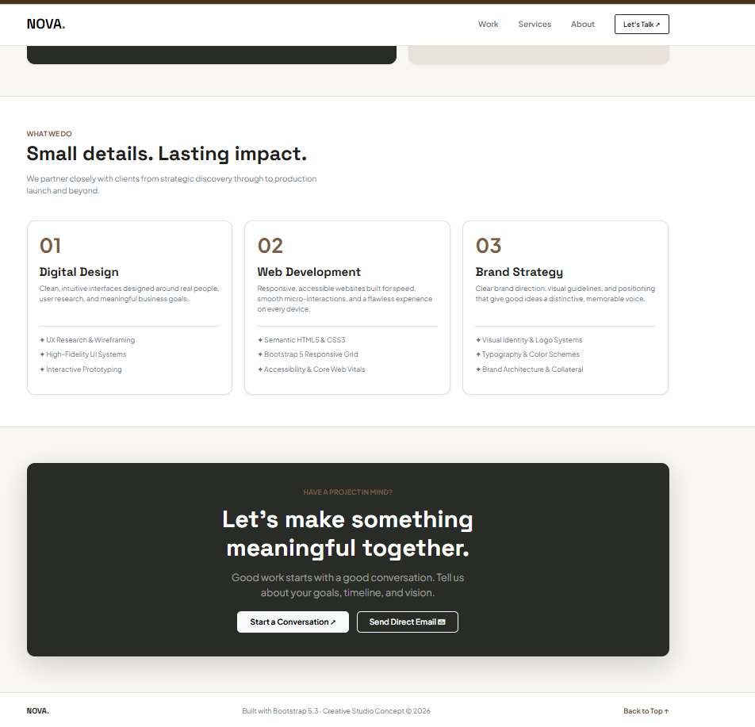

# 06. Bootstrap Nova Studio Landing

A modern agency landing page built using **native Bootstrap 5.3.3 components**, 12-column flexbox grid system, interactive modal dialog, and custom brand CSS variables.

---

## 📸 UI Preview

*Figure 6: Agency landing page demonstrating responsive Bootstrap navbar with mobile toggler, 12-column grid system, service cards, and an interactive inquiry modal dialog.*

---

## 🚀 Live Demo
- **Live URL**: [https://sowndharyapl15.github.io/frontend-task/Bootstrap-nova-landing/](https://sowndharyapl15.github.io/frontend-task/Bootstrap-nova-landing/)

---

## 🛠️ Tech Stack & Key Topics Demonstrated

- **Bootstrap 5.3.3 Components**: Pre-styled responsive components including `navbar navbar-expand-lg`, `card rounded-4`, `badge`, and `modal fade`.
- **12-Column Responsive Grid**: Mobile-first layout using `.container`, `.row`, `.g-4`, `.col-12`, `.col-md-7`, and `.col-md-5`.
- **Interactive JavaScript Inquiry Modal**: `#inquiryModal` dialog wired to trigger buttons via `data-bs-toggle="modal" data-bs-target="#inquiryModal"`.
- **CSS Variable Customization**: Custom design tokens (`--nova-accent`, `--nova-dark`, `--nova-sand`) harmonizing Bootstrap with NOVA branding.
- **Accessible Attributes**: Native ARIA modal attributes (`role="dialog"`, `aria-labelledby`, `aria-hidden`), keyboard focus trapping, and clean tab navigation.

---

## 📁 File Structure

- `index.html`: Landing page structure, responsive navbar, project grid, services, and inquiry modal.
- `Screenshot.png`: High-resolution UI preview screenshot.
