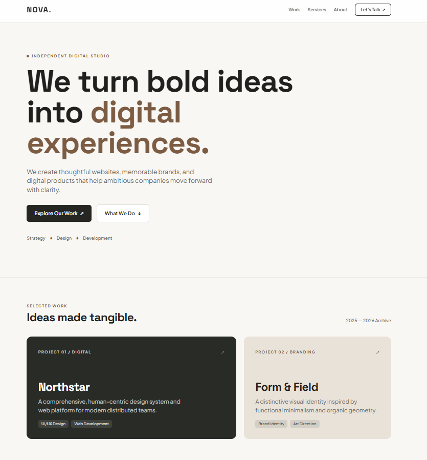

# 05. Tailwind Nova Studio Landing

A minimalist, high-conversion creative digital studio landing page built with **pure Tailwind CSS utility classes** and custom extended theme tokens.

---

## 📸 UI Preview

*Figure 5: Creative studio landing page showcasing sticky frosted-glass navigation, editorial hero typography, asymmetric 12-column project showcase grid, and interactive contact triggers.*

---

## 🚀 Live Demo
- **Live URL**: [https://sowndharyapl15.github.io/frontend-task/Tailwind-nova-landing/](https://sowndharyapl15.github.io/frontend-task/Tailwind-nova-landing/)

---

## 🛠️ Tech Stack & Key Topics Demonstrated

- **Pure Utility-First CSS**: Zero custom CSS stylesheets; 100% of styling implemented via inline Tailwind utility classes.
- **Custom Theme Configuration**: Extended studio color palette (`studio: #f8f7f4`, `charcoal: #20211f`, `accent: #7c5c43`, `darkpanel: #292b27`, `sand: #e8e2d9`) and custom font families (*Plus Jakarta Sans* & *Space Grotesk*).
- **Sticky Frosted Header**: `sticky top-0 bg-white/90 backdrop-blur-md` for a modern glassmorphic navigation bar.
- **Asymmetric 12-Column Grid**: Responsive layout using `grid grid-cols-1 md:grid-cols-12` with offset card spans (`md:col-span-7` and `md:col-span-5`).
- **Stateful Hover Effects**: `hover:-translate-y-1`, `hover:shadow-xl`, `group-hover:translate-x-1` transitions.
- **Interactive Call-to-Action**: One-click clipboard email copy script with instantaneous feedback.

---

## 📁 File Structure

- `index.html`: Complete single-page application with embedded Tailwind CDN configuration, semantic layout, and contact scripts.
- `Screenshot.png`: High-resolution UI preview screenshot.
