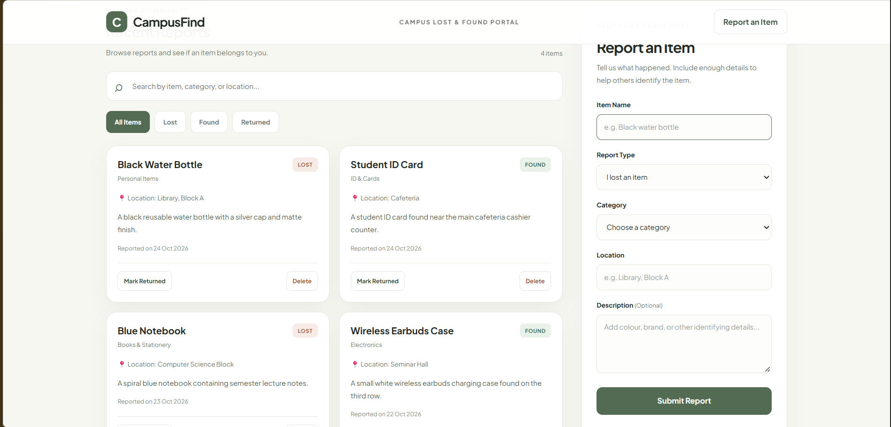

# 03. DOM Campus Lost & Found (CampusFind)

An interactive single-page web application for campus communities to report lost belongings, browse found items, and coordinate returns. Built with pure vanilla JavaScript DOM manipulation and Web Storage APIs.

---

## 📸 UI Preview

*Figure 3: Campus lost & found portal displaying live statistics summary, multi-field search bar, status filter pills, recent reports feed, and sticky report submission form.*

---

## 🚀 Live Demo
- **Live URL**: [https://sowndharyapl15.github.io/frontend-task/dom-campus-lost-found/](https://sowndharyapl15.github.io/frontend-task/dom-campus-lost-found/)

---

## 🛠️ Tech Stack & Key Topics Demonstrated

- **DOM Selection & Traversal**: `document.getElementById`, `querySelector`, `querySelectorAll`.
- **Dynamic DOM Creation**: Safe element generation using `document.createElement`, `replaceChildren`, and `textContent` (XSS prevention).
- **CRUD Operations**:
  - **Create**: Add new lost/found reports with form validation.
  - **Read**: Display reports feed with status badges and timestamps.
  - **Update**: Toggle item status to "Mark Returned".
  - **Delete**: Remove reports with user confirmation dialogs.
- **Search & Filtering**: Real-time filtering across titles, categories, locations, and descriptions combined with status buttons (`All`, `Lost`, `Found`, `Returned`).
- **Live Counters**: Dynamic calculation of total, lost, found, and returned item metrics.
- **Data Persistence**: `localStorage` integration preserving user submissions across browser reloads.
- **Mobile Responsive Drawer**: Collapsible report form drawer for screen widths `<= 720px`.

---

## 📁 File Structure

- `index.html`: Portal structure, statistics cards, filter toolbar, and report form.
- `style.css`: Clean grid/flexbox layout, status badges, and mobile drawer transitions.
- `script.js`: State management, event handlers, DOM creation, and `localStorage` synchronization.
- `Screenshot.png`: High-resolution UI preview screenshot.
