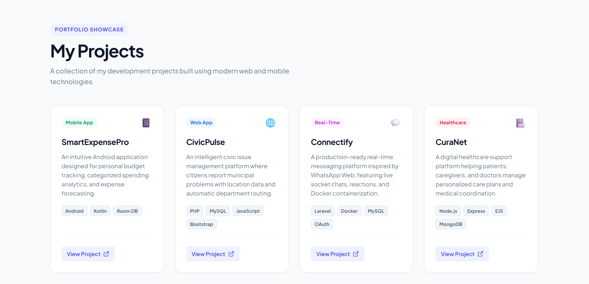

# 01. Responsive Card Layout

A modern, accessible project showcase card grid built with semantic HTML5, CSS Grid (2D container tracks), Flexbox (1D component alignment), and a strict mobile-first responsive workflow.

---

## 📸 UI Preview

*Figure 1: Responsive card grid demonstrating fluid columns, category badges, technology tags, and bottom-aligned action links.*

---

## 🚀 Live Demo
- **Live URL**: [https://sowndharyapl15.github.io/frontend-task/responsive-card-layout/](https://sowndharyapl15.github.io/frontend-task/responsive-card-layout/)

---

## 🛠️ Tech Stack & Key Topics Demonstrated

- **Semantic HTML5**: `<main>`, `<header>`, `<section aria-label="...">`, `<article>`, SVG icons.
- **CSS Box Model & Design Tokens**: `box-sizing: border-box`, `:root` custom properties for colors, shadows, and spacing.
- **CSS Grid**: Responsive 1-column (mobile), 2-column (tablet), and 4-column (desktop) tracks.
- **CSS Flexbox**: Vertical stacking inside cards with `margin-top: auto` for uniform footer button alignment.
- **Fluid Typography**: `font-size: clamp(...)` for scalable headings across screen sizes.
- **Micro-Interactions**: Hover elevation (`translateY(-6px)`), gradient highlight bar, and external link arrow translation.

---

## 📁 File Structure

- `index.html`: Semantic markup for 4 project cards (*SmartExpensePro*, *CivicPulse*, *Connectify*, *CuraNet*).
- `style.css`: Mobile-first styling rules, grid definitions, and component styles.
- `Screenshot.png`: High-resolution UI preview screenshot.
