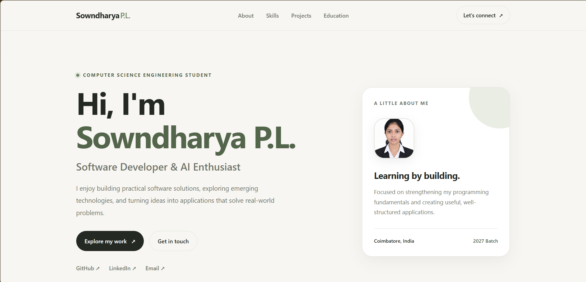

# 02. Static Profile Page

A personal software developer portfolio and profile page for **Sowndharya P.L.**, featuring semantic structure, an editorial color system, active navigation tracking, and accessible scroll reveals.

---

## 📸 UI Preview

*Figure 2: Software developer portfolio layout showcasing hero introduction, active status indicator, profile highlight card, and structured navigation.*

---

## 🚀 Live Demo
- **Live URL**: [https://sowndharyapl15.github.io/frontend-task/static-profile-page/](https://sowndharyapl15.github.io/frontend-task/static-profile-page/)

---

## 🛠️ Tech Stack & Key Topics Demonstrated

- **Semantic HTML5**: Landmark elements (`<header>`, `<nav>`, `<main>`, `<section>`, `<aside>`, `<footer>`), Open Graph meta tags, and structured heading hierarchy.
- **Modern CSS3**: Editorial light palette with design tokens (`:root`), CSS Grid for skills and projects, and flexbox alignment.
- **IntersectionObserver API**:
  - **Active Navigation Tracking**: Highlights matching nav link using `aria-current="location"` based on viewport intersection.
  - **Scroll Reveal Animations**: Smoothly animates section headings, skill pills, and project cards as they enter the screen.
- **Accessibility**: Motion-safe animations honoring `prefers-reduced-motion: reduce`, high-contrast text, and keyboard focus states.

---

## 📁 File Structure

- `index.html`: Portfolio content (Hero, About, Skills, Projects, Education, Contact).
- `style.css`: Clean design system, typography, responsive breakpoints, and animations.
- `script.js`: `IntersectionObserver` handlers for active nav link tracking and scroll reveals.
- `photo.png`: Profile photo asset.
- `Screenshot.png`: High-resolution UI preview screenshot.
